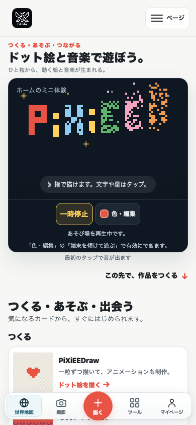

# ホームヒーローの常時再生修正（2026-10-13）

この文書は公開前のローカル検証記録。検証後、ユーザーから本修正のコミット・プッシュ・自動公開が明示承認された。

## 確認できた原因

公開 `https://pixieed.jp/js/home-play.mjs` と修正前の HEAD `7567294f` の同ファイルは SHA256 が一致した。
`38a8586503c49cfcb9ca52b2aa6c0ae15cf274ab6b96760a0647b71d320cab5a`

`reduced` は OS の `prefers-reduced-motion: reduce` とサイトの保存設定 `PiXiEED:motion-preference:v1` の OR で決まる。省略時の `step()` は `playPile(now, { animateBeat: false })` の後に return し、物理更新を実行しない。タッチで音は有効になるため、センサーが入力を送っていても描画・落下・傾き反映が止まり、音だけが鳴り続ける。取得した公開ソースをブラウザーに読み込む再現テストでも、AudioContext が running、描画ドットが静止することを確認した。

報告された Android で実際にどちらの省略設定が有効かは未確認。ただし最終仕様では、ホームヒーローの再生はどちらの設定でも止まらない。

## 実装

- ユーザーの「再生は常に再生していて欲しいです」という仕様変更に合わせ、ヒーローは初回ロードから自動再生する。OS・保存済みサイト設定・ライブの設定変更でヒーローの物理・視覚更新を停止しない。省略時は共有スケジューラーの30 FPS上限と他のカードの静止を維持し、設定自体や他ページは変えない。
- 控えめな「一時停止」は物理更新と音を停止。停止中のキャンバスタッチで音を勝手に再開しない。新しい激しい演出や点滅は追加しない。
- 端末傾きの操作は再生中にだけ有効。権限は明示的な傾き操作から要求。非対応・拒否・有効なサンプルが届かない場合は、見える案内でタッチ描画を説明する。遅れてセンサーサンプルが届いた場合は回復する。
- 非表示・画面外では映像、センサー、音を省電力停止し、表示復帰で映像と許可済みのセンサーを自動再開する。音は初回のユーザー操作まで生成しない。一度ユーザー操作で開始済みの音だけを復帰時に再開する。ブラウザーが再操作を必要とする場合はタッチで回復できる。手動停止は復帰後も維持する。画面復帰の物理時間をリセットし、権限要求中の pagehide にも対応する。
- 関連モジュールと CSS のキャッシュ用 revision を更新。

## 検証

| 検証 | 結果 |
| --- | --- |
| 関連 Node テスト | 78/78 通過 |
| 全288 `.test.mjs` | 1,981/1,984 通過。失敗3件は既知のイベント固定件数だけ |
| `node --check`（変更した JS とブラウザーハーネス）・`git diff --check` | 通過 |
| 公開サイトビルド | 成功。693ファイル、イベント96ページ、パズル6ページ |
| Chromium 151.0.7922.34 | 13ケース通過。詳細は [browser.json](evidence/browser.json) |

ブラウザー試験は公開ソースによる不具合再現、320×568・390×844・844×390・1280×800の通常／省略8組合せでの操作前からの視覚更新と操作前の音の未生成、保存された省略設定、ライブの設定変更、タッチのドラッグ、合成センサーの重力反映、再生停止3回、センサー非対応・権限拒否・サンプルなし、IntersectionObserverなし、途中の縦横回転、pagehide/pageshow、visibilitychange、完全に画面外へのスクロールと復帰時の映像・操作済み音の自動再開を確認した。外部リクエストは試験中に遮断している。音の単体試験は自動再開拒否からのタッチ回復、手動停止、自動再開と新しい操作の競合も確認した。

全体試験の3件は `tests/site/event-pages.test.mjs` の固定期待値（108レコード／92ページ）と既存データ（113レコード／96ページ）の不一致。今回のヒーローの失敗ではない。イベントのテストやデータは変更していない。

Android実機・実際の端末センサー・実際のスピーカー出力は未確認。ソフトウェア上の AudioContext・発音要求・キャンバス画素と合成センサーを確認した。このローカル検証時点では公開サイトは修正していない。

## 再実行・プレビュー

```sh
node --test tests/home/*.test.mjs tests/creation-suite/site-interactions.test.mjs tests/creation-suite/pages-build.test.mjs tests/creation-suite/seo.test.mjs
python3 -m http.server 4184 --bind 127.0.0.1
PIXIEED_PLAYWRIGHT_MODULE=/path/to/existing/playwright/index.mjs node scripts/home-playback-browser-harness.mjs
node scripts/build-pages-site.mjs --output /tmp/new-pixieed-home-build
```

ハーネスは既存の Playwright を使う。公開ソースの再現は、読み取ったファイルを `PIXIEED_HOME_BASELINE` に指定した場合だけ実行する。通常の実行では修正後の12ケースを確認する。

ローカルプレビュー: [http://127.0.0.1:4184/](http://127.0.0.1:4184/)



## Git と範囲

開始時の作業ツリーは clean、HEAD は `7567294f`。リポジトリ内・親ディレクトリに AGENTS.md と `.agents/skills` はなく、個人 `~/.codex/AGENTS.md` と `pixieed-luna-workflow/SKILL.md`、既存試験・ビルド手順を読んだ。限定した実装を Luna に委譲し、主担当がセンサー修正・コードレビュー・ブラウザー試験・最終受け入れを実施した。

仕様変更時は前回修正の未コミットファイルをそのまま引き継ぎ、変更を保護した。ビルドが再生成するイベントページと sitemap は、開始時の clean な内容へ戻した。ビルド先のホーム6ファイルが最終作業ツリーと一致することを確認した。作品・認証・広告設定への変更はない。検証時点ではコミット・プッシュ・本番公開は未実施で、後から明示承認された公開作業は同じ範囲の変更を対象にする。
